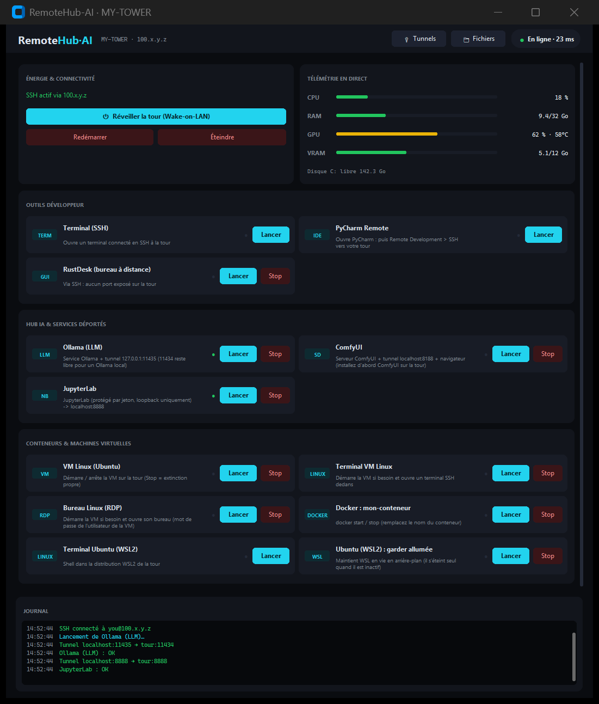

<div align="center">

# RemoteHub-AI

**Contrôlez votre PC fixe depuis n'importe où : allumez-le, ouvrez un terminal, lancez des modèles d'IA, parcourez ses fichiers, utilisez une VM Linux, depuis une seule appli de bureau sombre et simple. Privé par conception : rien n'est exposé sur Internet.**

[](https://github.com/anthime24/remotehub-ai/actions/workflows/ci.yml)


🇬🇧 [English](README.md) · 🇫🇷 Français



<sub>Capture générée avec <code>python main.py --demo</code> : données factices, aucune vraie machine.</sub>

</div>

---

## Pourquoi ?

Vous avez un PC puissant à la maison (GPU, beaucoup de RAM, gros disques) et un laptop plus léger. Vous voulez utiliser le
premier depuis le second, depuis le canapé, le train ou un café, **sans** ouvrir de ports sur votre box, payer un GPU dans
le cloud, ni jongler avec cinq outils. RemoteHub-AI est le cockpit : une fenêtre, une session SSH, et tout le reste s'y accroche.

## Ce que vous obtenez

| | |
|---|---|
| ⏻ **Wake-on-LAN** | Allumez la tour (même réseau, via un relais toujours allumé, ou par l'API de votre box) |
| 📊 **Télémétrie en direct** | CPU, RAM, GPU, VRAM, température, disque libre, rafraîchis toutes les quelques secondes |
| 🖥 **Lanceurs** | Terminal (Warp / Windows Terminal), PyCharm Remote, RustDesk, **Ollama**, **ComfyUI**, **JupyterLab**, Docker, WSL2 |
| 🐧 **Une vraie machine Linux** | VM Ubuntu (VirtualBox) avec bureau graphique, démarrée/arrêtée depuis l'appli |
| 🔌 **Tunnels & SOCKS5** | Ouvrez le `localhost:3000` *de la tour* sur votre laptop, ou naviguez via le réseau de la tour |
| 📁 **Explorateur de fichiers** | Parcourir, chercher, télécharger, envoyer des dossiers en SFTP, avec progression et annulation |
| 🛡 **Sécurité par défaut** | Tailscale + clés SSH, clé d'hôte épinglée, services en loopback, verrouillage du pare-feu en une commande |
| 🌍 **Français & anglais** | Interface et documentation |
| 🧩 **Extensible par configuration** | Ajoutez un lanceur en dix lignes de YAML, sans code |

## Comment ça marche

```
 ┌──────────┐  Tailscale (chiffré, privé)        ┌─────────────────────────────┐
 │  Laptop  │════════════════════════════════════│  Tour (Windows)             │
 │          │        UNE session SSH             │   sshd :22  ← seule porte   │
 │ RemoteHub│  commandes · tunnels · SOCKS · SFTP│   127.0.0.1: Ollama, Jupyter│
 └──────────┘                                    │   ComfyUI, RustDesk, VM     │
                                                 └─────────────────────────────┘
      ✗ aucun port redirigé sur votre box · ✗ aucun relais cloud qui garde vos données
```

## Démarrage rapide (≈ 30 minutes, une seule fois)

1. **Tour** : installez [Tailscale](https://tailscale.com/download), puis lancez `tower\Setup-Tower.ps1` (en administrateur).
   → [Guide de la tour](docs/fr/01-installation-tour.md)
2. **Laptop** : installez Tailscale (même compte) et Python 3.10+, puis :
   ```powershell
   git clone https://github.com/anthime24/remotehub-ai.git
   cd remotehub-ai
   run.bat                      # le premier lancement crée config.yaml : indiquez l'IP, l'utilisateur et la MAC de la tour
   ```
   → [Guide du laptop](docs/fr/02-installation-laptop.md)
3. `python tools\deploy_tower.py` copie les scripts de services sur la tour. Appuyez sur **Réveiller**, puis sur une carte. C'est tout.

Simple curiosité ? `python main.py --demo` montre l'interface avec des données factices et ne touche à rien.

## Documentation

| | |
|---|---|
| [1 · Préparer la tour](docs/fr/01-installation-tour.md) | Tailscale, SSH, connexion par clé, pare-feu, logiciels optionnels |
| [2 · Préparer le laptop](docs/fr/02-installation-laptop.md) | Installation, configuration, première connexion, usage quotidien |
| [3 · Wake-on-LAN](docs/fr/03-wake-on-lan.md) | BIOS, Windows, hors de votre réseau (relais / Freebox) |
| [4 · VM Linux](docs/fr/04-vm-linux.md) | Ubuntu VirtualBox avec bureau, piloté depuis l'appli |
| [5 · Configuration](docs/fr/05-configuration.md) | Chaque réglage, chaque type d'étape, recettes |
| [6 · Sécurité](docs/fr/06-securite.md) | Modèle de menace, liste de durcissement, ACL Tailscale |
| [7 · Dépannage](docs/fr/07-depannage.md) | Symptômes → solutions |

## Sécurité en bref

- **Rien n'est exposé sur Internet.** Le seul service joignable est SSH, et seulement via Tailscale après verrouillage.
- **Tout le reste passe dans la session SSH** et écoute sur `127.0.0.1` de la tour.
- **Les clés d'hôte sont épinglées** : si la clé de la tour change, l'appli refuse et vous explique pourquoi.
- **Vos données privées n'atteignent jamais git** : `config.yaml` et les secrets sont ignorés, un contrôleur de confidentialité
  bloque les commits qui contiennent IP, MAC, jetons ou clés, et la CI l'exécute aussi.
- Modèle complet et risques résiduels : [Guide sécurité](docs/fr/06-securite.md) · [SECURITY.md](SECURITY.md).

## Prérequis et limites

- **Laptop :** Windows 10/11, Python 3.10+. **Tour :** Windows 10/11 (Famille convient). Les deux sur le même compte Tailscale.
- Le Wake-on-LAN demande une tour filaire et une option du BIOS ; hors du LAN il faut un relais ou une API de box.
- Windows d'abord : le client utilise Tk, `mstsc` et PowerShell. Un client macOS/Linux ou une tour Linux ne sont pas
  encore gérés (contributions bienvenues).
- **Certains réseaux (écoles, entreprises) bloquent Tailscale.** RemoteHub-AI n'essaie pas de les contourner ; voir le
  [dépannage](docs/fr/07-depannage.md#réseaux-qui-bloquent-tailscale) pour savoir quoi faire à la place.
- ComfyUI, Ollama, Jupyter, RustDesk et VirtualBox sont des programmes distincts que vous installez sur la tour ; ce projet les pilote.

## FAQ

**Est-ce sûr sur un Wi-Fi public ?** Oui : le trafic passe par Tailscale/SSH. Protégez votre clé par une phrase de passe.

**Dois-je ouvrir un port sur ma box ?** Non. Merci de ne pas le faire.

**Pourquoi pas simplement le Bureau à distance / TeamViewer ?** Ils donnent un écran. RemoteHub-AI donne un *flux de travail* :
réveil, services qui survivent à la déconnexion, tunnels vers vos outils, fichiers, une VM, et vous gardez la maîtrise du chemin réseau.

**Puis-je l'utiliser sans GPU / sans IA ?** Oui. Les cartes IA sont des exemples facultatifs ; supprimez-les ou remplacez-les dans `config.yaml`.

**Ça marche avec un autre VPN que Tailscale ?** Tout ce qui donne à la tour une IP joignable convient : mettez-la dans
`connection.tailscale_ip` (le nom est historique). Les guides et le modèle de sécurité supposent Tailscale.

## Contribuer

Les issues et pull requests sont bienvenues en français ou en anglais : voir [CONTRIBUTING.md](CONTRIBUTING.md) (dont
comment ajouter une langue). Lancez `python tools/check_privacy.py` avant de pousser et n'incluez jamais de vraies IP ou de
noms de machines.

## Licence

[MIT](LICENSE) © RemoteHub-AI contributors
