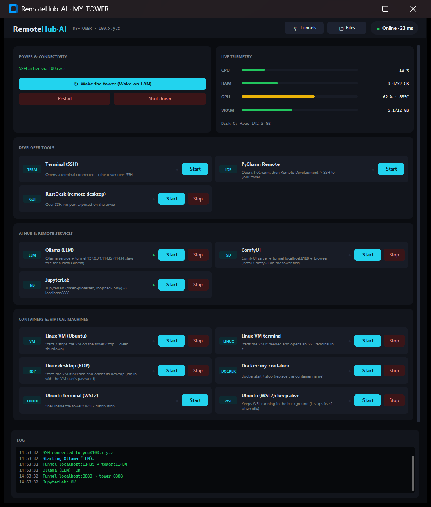

<div align="center">

# RemoteHub-AI

**Control your home PC from anywhere — turn it on, open a terminal, run AI models, browse its files, use a Linux VM — from one dark, simple desktop app. Private by design: nothing exposed to the Internet.**

[](https://github.com/anthime24/remotehub-ai/actions/workflows/ci.yml)


🇬🇧 English · 🇫🇷 [Français](README.fr.md)



<sub>Screenshot generated with <code>python main.py --demo</code>: fake data, no real machine.</sub>

</div>

---

## Why?

You have a powerful PC at home (GPU, lots of RAM, big disks) and a lighter laptop. You want to use the first from the
second — from the couch, the train or a café — **without** opening ports on your router, paying for a cloud GPU, or
juggling five different tools. RemoteHub-AI is the cockpit: one window, one SSH session, everything else hangs off it.

## What you get

| | |
|---|---|
| ⏻ **Wake-on-LAN** | Switch the tower on (same LAN, via an always-on relay, or through your router's API) |
| 📊 **Live telemetry** | CPU, RAM, GPU, VRAM, temperature, free disk — refreshed every few seconds |
| 🖥 **Launchers** | Terminal (Warp / Windows Terminal), PyCharm Remote, RustDesk, **Ollama**, **ComfyUI**, **JupyterLab**, Docker, WSL2 |
| 🐧 **A real Linux machine** | Ubuntu VM (VirtualBox) with a graphical desktop, started/stopped from the app |
| 🔌 **Tunnels & SOCKS5** | Open `localhost:3000` *of the tower* on your laptop, or browse through the tower's network |
| 📁 **File explorer** | Browse, search, download, upload folders over SFTP, with progress and cancel |
| 🛡 **Secure defaults** | Tailscale + SSH keys, host-key pinning, loopback-only services, one-command firewall lock-down |
| 🌍 **English & French** | UI and documentation |
| 🧩 **Extensible by config** | Add a launcher with ten lines of YAML — no code |

## How it works

```
 ┌──────────┐  Tailscale (encrypted, private)   ┌─────────────────────────────┐
 │  Laptop  │═══════════════════════════════════│  Tower (Windows)            │
 │          │          ONE SSH session          │   sshd :22  ← only door     │
 │ RemoteHub│  commands · tunnels · SOCKS · SFTP│   127.0.0.1: Ollama, Jupyter│
 └──────────┘                                   │   ComfyUI, RustDesk, VM     │
                                                └─────────────────────────────┘
        ✗ no port forwarded on your router · ✗ no cloud relay holding your data
```

## Quick start (≈ 30 minutes, once)

1. **Tower** — install [Tailscale](https://tailscale.com/download), then run `tower\Setup-Tower.ps1` (as admin).
   → [Tower guide](docs/en/01-tower-setup.md)
2. **Laptop** — install Tailscale (same account) and Python 3.10+, then:
   ```powershell
   git clone https://github.com/anthime24/remotehub-ai.git
   cd remotehub-ai
   run.bat                      # first run creates config.yaml: fill in your tower's IP, user and MAC
   ```
   → [Laptop guide](docs/en/02-laptop-setup.md)
3. `python tools\deploy_tower.py` copies the service scripts to the tower. Press **Wake**, then any card. Done.

Just curious? `python main.py --demo` shows the interface with fake data and touches nothing.

## Documentation

| | |
|---|---|
| [1 · Tower setup](docs/en/01-tower-setup.md) | Tailscale, SSH, key login, firewall, optional software |
| [2 · Laptop setup](docs/en/02-laptop-setup.md) | Install, configure, first connection, daily use |
| [3 · Wake-on-LAN](docs/en/03-wake-on-lan.md) | BIOS, Windows, from outside your LAN (relay / Freebox) |
| [4 · Linux VM](docs/en/04-linux-vm.md) | VirtualBox Ubuntu with desktop, driven from the app |
| [5 · Configuration](docs/en/05-configuration.md) | Every setting, every step type, recipes |
| [6 · Security](docs/en/06-security.md) | Threat model, hardening checklist, Tailscale ACLs |
| [7 · Troubleshooting](docs/en/07-troubleshooting.md) | Symptoms → fixes |

## Security at a glance

- **Nothing is exposed to the Internet.** The only reachable service is SSH, and only through Tailscale after lock-down.
- **Everything else rides inside the SSH session** and listens on `127.0.0.1` of the tower.
- **Host keys are pinned**: if the tower's key changes, the app refuses and tells you why.
- **Your private data never reaches git**: `config.yaml` and secrets are ignored, a privacy checker blocks commits that
  contain IPs, MACs, tokens or keys, and CI runs it too.
- Full model and residual risks: [Security guide](docs/en/06-security.md) · [SECURITY.md](SECURITY.md).

## Requirements & limits

- **Laptop:** Windows 10/11, Python 3.10+. **Tower:** Windows 10/11 (Home works). Both on the same Tailscale account.
- Wake-on-LAN needs a wired tower and a BIOS option; from outside the LAN it needs a relay or a router API.
- Windows-first: the client uses Tk, `mstsc` and PowerShell. A macOS/Linux client or a Linux tower are not supported yet
  (contributions welcome).
- **Some networks (schools, companies) block Tailscale.** RemoteHub-AI will not try to bypass them; see
  [Troubleshooting](docs/en/07-troubleshooting.md#networks-that-block-tailscale) for what to do instead.
- ComfyUI, Ollama, Jupyter, RustDesk and VirtualBox are separate programs you install on the tower; this project drives them.

## FAQ

**Is it safe to use on public Wi-Fi?** Yes: traffic goes through Tailscale/SSH. Keep your key passphrase-protected.

**Do I need to open a port on my router?** No. Please don't.

**Why not just use Remote Desktop / TeamViewer?** They give you a screen. RemoteHub-AI gives you a *workflow*: wake, services
that survive disconnection, tunnels to your tools, files, a VM — and you keep control of the network path.

**Can I use it without a GPU / without AI?** Yes. The AI cards are optional examples; delete or replace them in `config.yaml`.

**Does it work with another VPN than Tailscale?** Anything that gives the tower a reachable IP works: put it in
`connection.tailscale_ip` (the name is historical). Tailscale is what the guides and security model assume.

## Contributing

Issues and pull requests are welcome in English or French — see [CONTRIBUTING.md](CONTRIBUTING.md) (also: how to add a
language). Please run `python tools/check_privacy.py` before pushing and never include real IPs or machine names.

## License

[MIT](LICENSE) © RemoteHub-AI contributors
